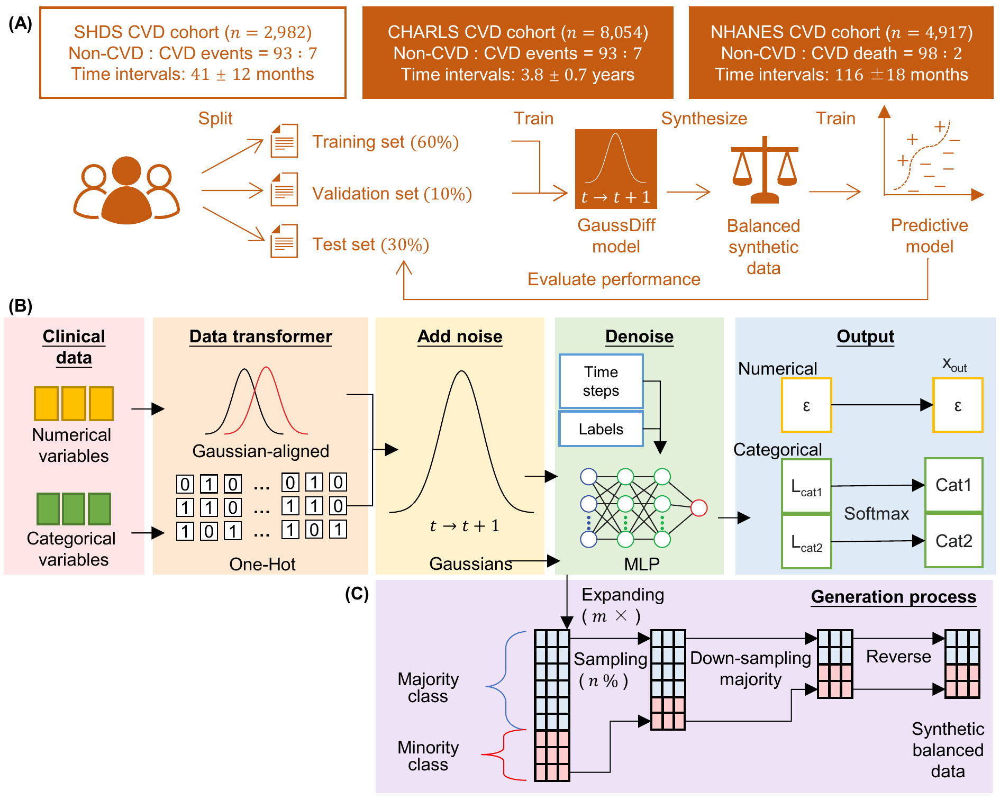

# Gaussian-aligned generative modeling enables prognostic detection of low-incidence events in clinical data

Official implementation of **Gaussian-aligned generative modeling enables prognostic detection of low-incidence events in clinical data**.

## Overview

GaussDiff introduces a **Gaussian alignment strategy** for diffusion-based synthetic data generation, specifically designed to address severe class imbalance in clinical prediction tasks. By aligning feature distributions to Gaussian space before diffusion modeling, GaussDiff achieves superior performance in recall, ROC-AUC, and survival analysis across multiple healthcare datasets.



*(A vector version of this figure is available as [`output-1.pdf`](output-1.pdf).)*


## Installation

### Prerequisites
- Python 3.9 (the pinned versions in `requirements.txt` target 3.9.18)
- CUDA-compatible GPU (recommended)

### Install Dependencies
```bash
git clone https://github.com/enai4bio/GaussDiff.git
cd GaussDiff
pip install -r requirements.txt
pip install --no-deps rtdl==0.0.9 libzero==0.0.8
```

`rtdl` and `libzero` are installed with `--no-deps` because both declare
`torch<2` in their metadata, while the reported experiments were run against
`torch 2.8.0`, with which both work correctly. Their own dependencies are
pinned in `requirements.txt`. See the header of that file for details.

A conda environment specification is also provided in `environment.yaml`.

## Quick Start

### CHARLS Example

> **Note:** CHARLS data is not included in this repository. Apply for access
> at the [CHARLS official website](https://charls.pku.edu.cn/) and place the
> approved extract in `CHARLS/data/1_origin/` first. See
> [Data Availability](#data-availability).

```bash
cd CHARLS

# Full pipeline (train → sample → evaluate)
python run.py --wd . --job train_sample_eval

# --config is optional; it defaults to configs/charls.toml
python run.py --wd . --job train_sample_eval --config configs/charls.toml

# Or run stages individually:
python run.py --wd . --job train
python run.py --wd . --job sample
python run.py --wd . --job eval
```

### NHANES Example
```bash
cd NHANES
python run.py --wd . --job train_sample_eval
```

> **Note:** a `train` job starts from a clean `results/`. If one already
> exists it is not deleted but renamed to `results_backup_<timestamp>/`, so
> output from earlier runs is preserved. Remove old backups yourself when you
> no longer need them.

## Configuration

Edit `configs/*.toml` to customize your experiment:

```toml
[main]
work_dir = "."              # Working directory
device = "cuda:0"           # GPU device

[data.y]
label_column = "CVD"        # Target variable
num_classes = 2

[data.x]
numerical_feature_columns = ['Age', 'BMI', ...]
categorical_feature_columns = ['Gender', 'Diabetes', ...]

[train.main]
steps = 8000                # Training steps
init_lr = 0.00013           # Learning rate
seed = 0                    # Random seed
```

### Network Architecture Selection

The two released configurations:

| Dataset | n | `d_layers` | `dim_t` |
|---------|---|-----------|---------|
| CHARLS | 8,054 | `[512,512,512,512,512,256]` | 128 |
| NHANES | 4,917 | `[256,256,256]` | 256 |

A deeper network suits the larger cohort; a 3-layer network limits
overfitting on the smaller one. `dim_in` is recomputed from the data at
training time, so the value in the config is informational.

The NHANES `dim_t = 256` above is the value carried by the released
checkpoint (its `proj`, `time_embed` and `label_emb` tensors are all 256-wide)
and by the configuration recorded for that training run.

### Core Hyperparameters

All experiments use consistent diffusion parameters:
- **n_timesteps**: 1000
- **scheduler**: cosine
- **normalization**: minmax
- **dropout**: 0.0
- **weight_decay**: 0.0

## Results

Performance on CHARLS CVD prediction (mean ± std over 15 independent runs):

| Method | Sensitivity | ROC-AUC | PR-AUC |
|--------|-------------|---------|--------|
| **GaussDiff** | **0.596 ± 0.018** | **0.600 ± 0.009** | 0.087 ± 0.004 |
| TVAE | 0.479 ± 0.057 | 0.524 ± 0.008 | 0.069 ± 0.002 |
| CTGAN | 0.196 ± 0.051 | 0.580 ± 0.025 | 0.087 ± 0.009 |
| SMOTE | 0.070 ± 0.007 | 0.529 ± 0.003 | 0.069 ± 0.001 |
| ADASYN | 0.065 ± 0.004 | 0.526 ± 0.003 | 0.068 ± 0.001 |
| Random oversampling | 0.000 ± 0.000 | 0.548 ± 0.004 | 0.076 ± 0.001 |

Performance on NHANES CVD prediction (mean ± std over 15 independent runs):

| Method | Sensitivity | ROC-AUC | PR-AUC |
|--------|-------------|---------|--------|
| **GaussDiff** | **0.904 ± 0.036** | 0.873 ± 0.010 | 0.179 ± 0.017 |
| TVAE | 0.485 ± 0.049 | 0.795 ± 0.011 | 0.127 ± 0.018 |
| CTGAN | 0.313 ± 0.170 | 0.763 ± 0.107 | 0.094 ± 0.052 |
| SMOTE | 0.107 ± 0.010 | 0.862 ± 0.004 | 0.134 ± 0.005 |
| ADASYN | 0.109 ± 0.007 | 0.862 ± 0.003 | 0.134 ± 0.003 |
| Random oversampling | 0.000 ± 0.000 | **0.875 ± 0.008** | **0.246 ± 0.012** |

Note: on NHANES, random oversampling attains the highest ROC-AUC and PR-AUC
while identifying none of the minority-class cases (sensitivity = 0). A model
that detects no high-risk patients is clinically uninformative despite those
favorable rank-based scores, which is why sensitivity is the operative
criterion in this low-incidence setting.

Values are reproduced from Tables S2(b) and S2(c) of the paper. Full results,
including the SHDS and pregnancy cohorts and 95% confidence intervals, are
reported there.

## Evaluation Framework

GaussDiff evaluates synthetic data quality across three independent dimensions:

1. **Classification Performance**
   - Sensitivity (minority-class detection rate)
   - ROC-AUC (ranking quality)
   - PR-AUC (precision-recall trade-off)

2. **Distribution Fidelity**
   - DCR (Distance to Closest Record)
   - Measures feature distribution similarity

3. **Temporal Risk Stratification**
   - Kaplan-Meier survival analysis
   - Log-rank test for group separation

These metrics assess different aspects independently: classification accuracy, feature distribution quality, and temporal progression prediction.

## Project Structure

```
GaussDiff/
├── CHARLS/                  # CHARLS dataset pipeline
│   ├── configs/
│   │   └── charls.toml
│   ├── data/                # (data not redistributed -- see Data Availability)
│   │   ├── 1_origin/        # Raw data -- place CHARLS extract here
│   │   ├── 2_split/         # Train/val/test splits
│   │   ├── 3_boxcox/        # Preprocessed data
│   │   ├── 4_km/            # Survival (Kaplan-Meier) event times
│   │   └── CHARLS_pretreatment.py   # Preprocessing script
│   ├── src/charls_pipeline/
│   │   ├── train.py         # Training module
│   │   ├── sample.py        # Sampling module
│   │   ├── eval.py          # Evaluation module
│   │   ├── core/lib/        # Shared utilities
│   │   └── models/          # Model implementations
│   ├── plot/                # Figures and metric summaries
│   └── run.py
├── NHANES/                  # NHANES dataset pipeline (same layout)
│   └── checkpoints/         # Released pretrained GaussDiff checkpoint
├── CITATION.cff
├── environment.yaml
├── LICENSE
├── README.md
└── requirements.txt
```

## Data Availability

The paper evaluates GaussDiff on four cohorts. This repository contains the
code for the two public ones.

**NHANES** (public). The preprocessed NHANES data used in the experiments is
included in `NHANES/data/`, and the original survey files are available from
the [NHANES website](https://www.cdc.gov/nchs/nhanes/).

**CHARLS** (available on application). CHARLS data is **not redistributed
here**: it is available to registered users upon approval of a data access
application. The CHARLS code and directory structure are included, with the
data directories left empty.

To reproduce the CHARLS experiments, apply for access through the
[CHARLS official website](https://charls.pku.edu.cn/), then place the approved
data extract into `CHARLS/data/1_origin/` and run the preprocessing script
`CHARLS/data/CHARLS_pretreatment.py` to regenerate `2_split/`, `3_boxcox/`
and `4_km/`.

**SHDS and the hospital pregnancy cohort** (not public). These contain
protected patient information and are not available in this repository. The
data are held by the Department of Endocrinology and Metabolism, Shanghai
Sixth People's Hospital Affiliated to Shanghai Jiao Tong University School of
Medicine. De-identified data may be made available to qualified researchers
upon reasonable request to the corresponding author, subject to ethics
approval and a data use agreement. Model weights trained on these two cohorts
are likewise not shared, because the models were trained on protected patient
data.

Synthetic datasets generated in the study are deposited on Zenodo.

## Pretrained Checkpoint

The trained GaussDiff denoising network for the NHANES CVD experiments is
included at `NHANES/checkpoints/diffusion.pt` (1.3 MB), together with the
configuration recorded by that training run and a loader helper. See
[`NHANES/checkpoints/README.md`](NHANES/checkpoints/README.md) for loading
instructions and checkpoint details.

Weights for CHARLS are not deposited; that model can be retrained with the
code and configuration here after obtaining CHARLS data access. Weights for
the SHDS and pregnancy cohorts are not shared (see Data Availability).

## Methodology

### Gaussian Alignment for Diffusion

Traditional diffusion models assume Gaussian noise schedules, which may not optimally handle non-Gaussian feature distributions common in clinical data. GaussDiff introduces a **Gaussian alignment preprocessing step** that transforms features into a space more amenable to diffusion modeling, leading to:

1. **Improved convergence** during training
2. **Better feature preservation** in synthetic samples  
3. **Enhanced minority class representation**

This alignment is performed adaptively per feature based on its statistical properties, ensuring optimal transformation for each variable.

### Class-Balanced Sampling Strategy

GaussDiff employs a two-stage sampling approach:
1. Generate oversampled candidates
2. Select balanced subsets maintaining target class distribution

This ensures synthetic datasets address the original class imbalance while preserving feature relationships.

## Citation

If you use this code, please cite the paper. Machine-readable metadata is in
[`CITATION.cff`](CITATION.cff).

```bibtex
@article{gaussdiff2026,
  title={Gaussian-aligned generative modeling enables prognostic detection of low-incidence events in clinical data},
  author={Zhang, Jie and Tumalisi, Julaiti and Suguro, Sei and Kudo, Takuya and Pan, Jiemin},
  journal={},
  year={2026}
}
```

## Acknowledgments

This project builds upon the diffusion modeling framework from [TabDDPM](https://github.com/yandex-research/tab-ddpm) (Kotelnikov et al., 2023):

```bibtex
@inproceedings{kotelnikov2023tabddpm,
  title={TabDDPM: Modelling Tabular Data with Diffusion Models},
  author={Kotelnikov, Akim and Baranchuk, Dmitry and Rubachev, Ivan and Babenko, Artem},
  booktitle={ICML},
  year={2023}
}
```

**Data Sources**:
- [CHARLS](https://charls.pku.edu.cn/): China Health and Retirement Longitudinal Study (access by application; not redistributed here)
- [NHANES](https://www.cdc.gov/nchs/nhanes/): National Health and Nutrition Examination Survey

## License

This project is licensed under the MIT License - see [LICENSE](LICENSE) for details.

Portions of the diffusion modeling code are derived from TabDDPM, which is also licensed under the MIT License. The original copyright and permission notice is reproduced in [LICENSE](LICENSE).

## Contact

For questions or issues:
- Open an issue on GitHub

## Contributing

Contributions are welcome! Please feel free to submit a Pull Request.
